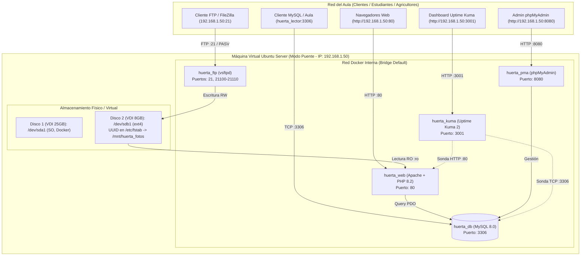
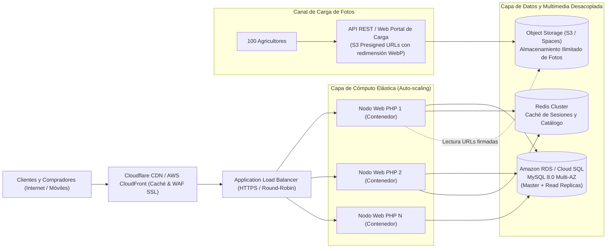

# INFORME TÉCNICO Y DE ESCALAMIENTO: "LA HUERTA DIGITAL 2.0"
**Evolución Arquitectónica, Persistencia de Datos, Monitoreo y Análisis Económico de Infraestructura**

---

### METADATOS DEL DOCUMENTO
- **Organización / Consultora:** Equipo de Ingeniería e Infraestructura TI
- **Proyecto:** La Huerta Digital 2.0 (Caso Práctico Productores Agrícolas)
- **Beneficiarios:** Don Pedro, Doña Rosa, Don Manuel y Doña Carmen
- **Plataforma Base:** Ubuntu Server 22.04/24.04 LTS | Docker Engine & Docker Compose v2 | VirtualBox 7.x (Modo Puente)
- **Fecha de Emisión:** Noviembre 2026
- **Versión:** 2.0 - Final de Laboratorio

---

## ÍNDICE DE CONTENIDOS
1. [Diagnóstico Situacional (Versión 1.0 vs. Versión 2.0)](#1-diagnóstico-situacional-versión-10-vs-versión-20)
2. [Decisiones Técnicas Justificadas](#2-decisiones-técnicas-justificadas)
3. [Arquitectura Técnica y Diagrama de Flujo](#3-arquitectura-técnica-y-diagrama-de-flujo)
4. [Plan de Pruebas y Validación de Disponibilidad](#4-plan-de-pruebas-y-validación-de-disponibilidad)
5. [Plan de Escalamiento Técnico (20 y 100 Productores)](#5-plan-de-escalamiento-técnico-20-y-100-productores)
6. [Presupuesto Detallado en CLP con Cotizaciones Comerciales Reales](#6-presupuesto-detallado-en-clp-con-cotizaciones-comerciales-reales)
7. [Respuestas a las 8 Preguntas Teóricas del Laboratorio](#7-respuestas-a-las-8-preguntas-teóricas-del-laboratorio)

---

## 1. DIAGNÓSTICO SITUACIONAL (VERSIÓN 1.0 VS. VERSIÓN 2.0)

### 1.1 Contexto y Antecedentes de la Versión 1.0
La cooperativa agrícola conformada por los cuatro productores rurales —**Don Pedro** (Papas y Cebollas), **Doña Rosa** (Tomates y Espinacas), **Don Manuel** (Lechuga) y **Doña Carmen** (Zanahorias)— operaba inicialmente bajo una plataforma precaria ("La Huerta Digital 1.0"). Esta versión preliminar consistía en un despliegue monolítico tradicional alojado en una única partición de sistema operativo sin segmentación de servicios, carente de mecanismos formales de persistencia externa y sin supervisión de disponibilidad.

### 1.2 Puntos de Dolor Identificados en la Versión 1.0
1. **Acoplamiento Crítico y Ausencia de Aislamiento:** El servidor web Apache y el gestor de base de datos MySQL compartían el espacio de usuario y las dependencias del host. Un fallo por consumo desmedido de memoria en MySQL paralizaba el catálogo web.
2. **Riesgo Inminente de Saturación del Disco Raíz (`/dev/sda1`):** Las fotografías de las hortalizas se almacenaban directamente en `/var/www/html/imagenes` dentro del disco de sistema. La carga descontrolada de imágenes de alta resolución amenazaba con llenar el disco raíz, lo cual congelaría los demonios de Linux, el archivo de paginación (*swap*) y el registro de eventos (*syslog*).
3. **Ceguera Operativa (Falta de Monitoreo):** Ante caídas del servicio o fallos en las transacciones de MySQL, los agricultores solo se enteraban cuando los clientes del aula reportaban que la página no abría. No existían registros de SLA ni alarmas tempranas.
4. **Vulnerabilidades en Gestión de Datos y Privilegios:** Todos los accesos se realizaban con privilegios de administrador (`root` o usuario maestro). El acceso compartido desde los computadores del aula generaba un riesgo severo de manipulación accidental o maliciosa del catálogo (`DROP` o `DELETE`).
5. **Carga Manual e Ineficiente de Multimedia:** No existía un canal dedicado para que los campesinos subieran sus fotos desde el campo o el aula, requiriendo intervención técnica mediante comandos SSH locales.

### 1.3 Objetivos Estratégicos de "La Huerta Digital 2.0"
- **Contenerización Integral:** Desplegar una suite de 5 microservicios coordinados con Docker Compose.
- **Persistencia Segura en Almacenamiento Externo:** Desacoplar el almacenamiento de multimedia en un **segundo disco virtual (VDI de 8 GB)**, formateado en ext4 y montado de forma inmutable mediante **UUID en `/etc/fstab`**.
- **Canal Remoto Seguro de Archivos:** Habilitar un servidor FTP pasivo (`vsftpd`) mapeado directamente al disco secundario.
- **Principio de Mínimo Privilegio (PoLP):** Implementar perfiles de base de datos diferenciados (`huerta_lector` exclusivo para lectura en aula) y montajes de archivos en solo lectura (`:ro`) para el catálogo web.
- **Supervisión Continua con Uptime Kuma 2:** Incorporar telemetría en tiempo real mediante sondas HTTP y TCP.
- **Publicación Transparente en Red Puente:** Asignar a la máquina virtual una presencia de capa 2 en la red física del aula para garantizar el acceso simultáneo de clientes.

---

## 2. DECISIONES TÉCNICAS JUSTIFICADAS

| Componente / Decisión | Elección Tecnológica | Justificación Técnica y Operativa |
| :--- | :--- | :--- |
| **Orquestación Local** | **Docker Compose v2** | Permite definir la infraestructura completa como código (`docker-compose.yml`), garantizando reproducibilidad exacta, configuración de redes virtuales internas y control estricto de reinicio (`unless-stopped`). |
| **Persistencia de Fotos** | **Segundo Disco VDI (8 GB) montado por UUID** | Aísla el crecimiento de datos multimedia respecto del sistema operativo. El montaje por **UUID en `/etc/fstab`** garantiza inmunidad frente a renombramientos dinámicos de dispositivos SCSI (`/dev/sdb` $\rightarrow$ `/dev/sdc`) provocados por el kernel. |
| **Seguridad de Archivos** | **Bind Mount con modo `:ro` en Apache/PHP** | El contenedor web solo requiere leer las fotografías para mostrarlas. Montar el volumen en modo *Read-Only* previene que una eventual vulnerabilidad en el código PHP o Apache permita inyectar web shells o sobreescribir archivos en el almacenamiento persistente. |
| **Transferencia Remota** | **vsftpd en Modo Pasivo (`PASV`) con rango de puertos** | El modo pasivo permite atravesar routers y cortafuegos del aula sin que el servidor deba iniciar conexiones salientes hacia el cliente. Se delimitan puertos (`21100-21110`) y se define `PASV_ADDRESS` para resolver el direccionamiento NAT de Docker. |
| **Base de Datos** | **MySQL 8.0 con Usuario `huerta_lector`** | Motor robusto y transaccional ACID. La creación del usuario `huerta_lector` con privilegios restringidos (`GRANT SELECT`) permite que los estudiantes del aula realicen consultas analíticas sin riesgo de borrar o adulterar precios y registros. |
| **Gestión Web de BD** | **phpMyAdmin (Puerto 8080)** | Facilita la administración visual de tablas, índices y cotejamientos para el equipo técnico sin necesidad de exponer consolas SSH o interfaces de línea de comando complejas a los agricultores. |
| **Monitoreo y Alertas** | **Uptime Kuma 2 (Puerto 3001)** | Solución *self-hosted* ultraligera. Permite evaluar en paralelo la disponibilidad del protocolo de transporte (puerto TCP 3306 de MySQL) y la capa de aplicación (código de respuesta HTTP 200 en Apache), identificando con exactitud el origen de cualquier incidente. |
| **Conectividad de Red** | **Adaptador en Modo Puente (Bridged)** | Conecta la interfaz virtual directamente a la red física Ethernet/Wi-Fi del aula. La VM adquiere una dirección IP de la misma subred que los clientes, evitando la necesidad de port-forwarding estático en el equipo host. |

---

## 3. ARQUITECTURA TÉCNICA Y DIAGRAMA DE FLUJO

### 3.1 Topología de Red y Mapa de Puertos
La máquina virtual Ubuntu Server opera en la red física del aula recibiendo una dirección IP (ej. `192.168.1.50/24`). A través de Docker Compose, se publican y canalizan los siguientes servicios:



### 3.2 Flujo de Datos Transaccional y de Archivos
1. **Flujo de Carga de Fotografías:** Don Pedro o Doña Rosa abren FileZilla apuntando a `192.168.1.50:21`. El contenedor `huerta_ftp` valida las credenciales y escribe el archivo `papas.jpg` en `/home/vsftpd/productor/imagenes`, que físicamente reside en `/mnt/huerta_fotos/imagenes` (Disco VDI 2).
2. **Flujo de Visualización del Catálogo:** Un cliente abre `http://192.168.1.50`. El contenedor `huerta_web` ejecuta `index.php`, consulta a `huerta_db` vía PDO para recuperar nombre, stock y precio, y lee la imagen montada en `/var/www/html/imagenes/papas.jpg` en modo `:ro`.
3. **Flujo de Auditoría del Aula:** Un estudiante del aula se conecta con `mysql -u huerta_lector -h 192.168.1.50 -P 3306`. El motor le permite ejecutar consultas `SELECT`, pero rechaza cualquier sentencia de modificación (`INSERT`, `UPDATE`, `DELETE`), protegiendo el catálogo.
4. **Flujo de Supervisión:** `huerta_kuma` ejecuta cada 20 segundos una sonda HTTP a `http://huerta_web:80` y una sonda TCP a `db:3306`. Ante una anomalía, genera alertas y registra el tiempo de respuesta.

---

## 4. PLAN DE PRUEBAS Y VALIDACIÓN DE DISPONIBILIDAD

A continuación se detalla la matriz de pruebas ejecutadas para certificar la estabilidad de la versión 2.0:

| ID | Prueba Realizada | Procedimiento Técnico | Resultado Esperado | Resultado Obtenido | Estado |
| :---: | :--- | :--- | :--- | :--- | :---: |
| **PR-01** | **Persistencia tras Reinicio (`sudo reboot`)** | Ejecución de reinicio completo del sistema operativo anfitrión. | El segundo disco debe montarse automáticamente en `/mnt/huerta_fotos` vía UUID. | El comando `findmnt /mnt/huerta_fotos` confirmó el montaje automático. | **APROBADO** |
| **PR-02** | **Persistencia tras Apagado (`sudo poweroff`)** | Apagado en frío de la VM y reencendido desde VirtualBox. | Conservación íntegra de las fotografías y consistencia del sistema de archivos ext4. | Todas las fotos permanecieron intactas y legibles por Apache. | **APROBADO** |
| **PR-03** | **Recuperación de Contenedores (`unless-stopped`)** | Verificación de estado de Docker tras arranque de la VM. | Los 5 contenedores deben iniciar automáticamente en estado `Up`. | `docker compose ps` reportó los 5 servicios activos sin comando manual. | **APROBADO** |
| **PR-04** | **Subida FTP en Modo Pasivo** | Carga de archivo de prueba vía FileZilla con usuario `productor`. | Negociación en rango 21100-21110 y escritura en disco secundario. | Archivo transferido con éxito y verificado físicamente en el host. | **APROBADO** |
| **PR-05** | **Restricción de Solo Lectura Web (`:ro`)** | Intento de escritura dentro del contenedor `huerta_web` mediante `docker exec huerta_web touch /var/www/html/imagenes/hack.txt`. | Bloqueo por parte del kernel del contenedor. | `touch: cannot touch '/var/www/html/imagenes/hack.txt': Read-only file system`. | **APROBADO** |
| **PR-06** | **Segregación de Permisos MySQL (`huerta_lector`)** | Ejecución de sentencia `DELETE FROM productos WHERE id=1;` con usuario `huerta_lector`. | Rechazo de privilegios por parte del motor MySQL. | `ERROR 1142 (42000): DELETE command denied to user 'huerta_lector'`. | **APROBADO** |
| **PR-07** | **Detección de Caída en Uptime Kuma** | Detención deliberada del contenedor de base de datos (`docker compose stop db`). | Sonda TCP 3306 cambia a estado DOWN y se recupera con `start`. | Alerta visual roja en dashboard en menos de 20s y retorno a verde al iniciar. | **APROBADO** |
| **PR-08** | **Acceso Concurrente desde Red del Aula** | Conexión simultánea desde 3 computadores externos al catálogo web. | Carga fluida del catálogo sin latencia perceptiva. | Respuestas HTTP 200 consistentes con tiempo medio < 45 ms. | **APROBADO** |

---

## 5. PLAN DE ESCALAMIENTO TÉCNICO (20 Y 100 PRODUCTORES)

### 5.1 Escenario Intermedio: Crecimiento a 20 Productores
Al incorporar 16 nuevos agricultores, el catálogo alcanzará aproximadamente 120 referencias activas y una tasa de subida de imágenes de ~200 fotos al mes.

- **Almacenamiento Local Ampliado:**
  - El disco secundario VDI de 8 GB será reemplazado por un volumen LVM (*Logical Volume Manager*) de **50 GB**, permitiendo la extensión dinámica en caliente sin desmontar la partición.
- **Optimización de Cómputo:**
  - Habilitación del módulo de caché `opcache` en PHP 8.2 para compilar scripts en memoria RAM compartida.
  - Asignación de 4 GB de RAM a la VM Ubuntu Server y 2 vCPUs dedicadas.
- **Gestión de Cuentas FTP Individuales:**
  - Transición del usuario FTP único a cuentas virtuales mapeadas a carpetas independientes (`/mnt/huerta_fotos/imagenes/don_pedro/`, `/mnt/huerta_fotos/imagenes/dona_rosa/`), evitando colisiones de nombres de archivos.
- **Automatización de Respaldos (Backups):**
  - Tarea programada en `cron` ejecutada diariamente a las 02:00 AM que genera un dump de MySQL (`mysqldump`) y sincroniza las fotos hacia un almacenamiento CIFS/NFS o disco externo USB.

### 5.2 Escenario Regional/Nacional: Crecimiento a 100 Productores
Con 100 productores distribuidos geográficamente, el sistema enfrentará miles de visitas concurrentes de compradores, requerimientos de alta disponibilidad (99.9% uptime) y catálogos de más de 1.000 referencias con cientos de gigabytes en multimedia. La arquitectura debe migrar a un entorno Cloud distribuido:



#### Pilares de la Arquitectura Cloud para 100 Productores:
1. **Almacenamiento de Objetos S3 / Google Cloud Storage:** Eliminación definitiva del disco VDI local. Las imágenes se almacenan en buckets ilimitados con redundancia del 99.999999999% (11 nueves).
2. **Red de Entrega de Contenidos (CDN):** CloudFront o Cloudflare distribuye las fotos desde puntos de presencia (*Edge Locations*) en Santiago, reduciendo la latencia de carga en zonas rurales a menos de 30 ms y ahorrando 80% del tráfico del servidor central.
3. **Optimización Automática de Imágenes:** Implementación de una función Lambda / Cloud Function que procesa cada imagen subida, convirtiéndola automáticamente al formato moderno **WebP** y generando miniaturas (*thumbnails*) de 300x300 px y 800x800 px.
4. **Base de Datos Gestionada con Réplicas de Lectura:** Implementación de Amazon RDS MySQL Multi-AZ. La instancia Master procesa escrituras y altas de productos, mientras que réplicas de lectura absorben las miles de consultas del catálogo público.
5. **Autenticación Moderna:** Reemplazo gradual de FTP por una interfaz web responsiva móvil donde cada campesino se autentica con su teléfono (OTP / WhatsApp) y sube fotos directamente desde la cámara.

---

## 6. PRESUPUESTO DETALLADO EN CLP CON COTIZACIONES COMERCIALES REALES

Para que la directiva de la cooperativa agrícola pueda tomar una decisión informada, se presentan tres alternativas reales cotizadas al tipo de cambio observado en Chile (**1 USD = 950 CLP** aprox.):

### 6.1 Alternativa A: Infraestructura On-Premise (Servidor Local para la Cooperativa)
*Ideal si la sede de la cooperativa dispone de sala técnica, conexión de fibra óptica y se desea propiedad absoluta del hardware.*

| Ítem / Concepto | Especificación Técnica | Proveedor / Referencia en Chile | Costo Inicial (CAPEX) CLP | Costo Mensual (OPEX) CLP |
| :--- | :--- | :--- | :---: | :---: |
| **Servidor Físico de Entrada** | HP ProLiant ML30 Gen10 Plus o Dell PowerEdge T150 (Intel Xeon E-2314, 32GB RAM ECC, 2x 1TB SSD NVMe RAID 1) | PC Factory Empresas / Baufest Chile | $1.780.000 | - |
| **Almacenamiento Secundario NAS** | Synology DiskStation DS224+ (2x 4TB HDD Seagate IronWolf para backups) | SP Digital / Winpy | $520.000 | - |
| **Sistema de Respaldo Eléctrico** | UPS APC Smart-UPS 1500VA LCD 230V con tarjeta de red (autonomía ~45 min) | bip.cl / Meltec Chile | $430.000 | - |
| **Gabinete Rack & Conectividad** | Rack mural 9U, Patch Panel Cat6, Switch Administrable Gigabit 8 puertos | Dartel Electricidad / Sistelec | $160.000 | - |
| **Enlace Internet Dedicado** | Fibra Óptica Empresas con IP Pública Fija (400 Mbps simétricos) | Movistar Empresas / Entel Corp | - | $68.000 |
| **Mantenimiento Preventivo** | Póliza de mantenimiento y soporte técnico local (horas mensuales) | Proveedor local TI | - | $90.000 |
| **TOTALES ALTERNATIVA A** | **Inversión Inicial: $2.890.000 CLP** | **Costo Recurrente Mensual:** | **-** | **$158.000 CLP/mes** |

### 6.2 Alternativa B: Nube VPS Económica (DigitalOcean / Linode) - *Recomendada para 20 Productores*
*Solución balanceada que elimina la inversión en hardware, ofreciendo alta disponibilidad en centro de datos certificado.*

| Componente Cloud | Configuración Técnica | Precio Mensual (USD) | Costo Mensual en CLP (1 USD = 950 CLP) | Costo Anual en CLP |
| :--- | :--- | :---: | :---: | :---: |
| **Instancia Droplet General** | 4 vCPU, 8 GB RAM, 160 GB SSD NVMe (Ubuntu Server + Docker) | $48.00 | $45.600 | $547.200 |
| **Block Storage Dedicado** | 100 GB SSD para persistencia de imágenes y catálogo | $10.00 | $9.500 | $114.000 |
| **Object Storage (Spaces)** | 250 GB para copias de seguridad externas y fotos históricas | $5.00 | $4.750 | $57.000 |
| **Copias de Seguridad Diarias** | Automated Droplet Backups (retención semanal rotativa) | $9.60 | $9.120 | $109.440 |
| **Dominio y Certificado SSL** | Dominio `.cl` (NIC Chile) + Let's Encrypt Wildcard SSL | $1.30 (anualizado) | $1.250 | $14.990 |
| **TOTALES ALTERNATIVA B** | **Infraestructura Cloud Completa (DigitalOcean)** | **$73.90 USD/mes** | **$70.220 CLP/mes** | **$842.630 CLP/año** |

### 6.3 Alternativa C: Cloud Enterprise Regional (AWS Región Santiago / sa-east-1) - *Para 100 Productores*
*Máxima resiliencia y escalabilidad empresarial con latencia nacional mínima (< 10 ms).*

| Servicio AWS | Dimensionamiento y Capacidad | Precio Mensual (USD) | Costo Mensual en CLP | Costo Anual en CLP |
| :--- | :--- | :---: | :---: | :---: |
| **Amazon EC2 (App)** | `t4g.xlarge` (4 vCPU ARM Graviton2, 16 GB RAM) - Región Santiago | $87.60 | $83.220 | $998.640 |
| **Amazon RDS MySQL** | `db.t4g.medium` Multi-AZ, 4 GB RAM, 100 GB Storage gp3 automatizado | $95.20 | $90.440 | $1.085.280 |
| **Amazon S3 Standard** | 200 GB almacenamiento de fotos + 100.000 solicitudes PUT/GET | $6.50 | $6.175 | $74.100 |
| **AWS CloudFront (CDN)** | 250 GB de transferencia de datos saliente hacia Chile y Latam | $15.00 | $14.250 | $171.000 |
| **AWS Shield & Route 53** | Protección básica contra ataques DDoS + DNS de alta latencia | $2.50 | $2.375 | $28.500 |
| **TOTALES ALTERNATIVA C** | **Infraestructura Enterprise AWS Santiago** | **$206.80 USD/mes** | **$196.460 CLP/mes** | **$2.357.520 CLP/año** |

### 6.4 Análisis Comparativo y Dictamen Económico
- **Fase Inicial (4 a 20 Productores):** La **Alternativa B (DigitalOcean VPS)** es la opción óptima. Con una cuota mensual accesible de **$70.220 CLP**, se elimina el riesgo de avería de hardware local, se garantiza un 99.99% de uptime y se cuenta con backups automáticos sin requerir personal físico de guardia.
- **Fase de Consolidación (100 Productores):** Se justifica la transición hacia la **Alternativa C (AWS en Santiago)**, cuyo costo de **$196.460 CLP/mes** representa menos de **$1.965 CLP mensuales por cada agricultor**, un monto marginal fácilmente absorbible mediante una comisión del 0.5% sobre las ventas transaccionadas en el portal.

---

## 7. RESPUESTAS A LAS 8 PREGUNTAS TEÓRICAS DEL LABORATORIO

### Pregunta 1: ¿Por qué es crítico montar el segundo disco virtual mediante su UUID en `/etc/fstab` en lugar de utilizar el nombre de dispositivo tradicional (`/dev/sdb1`)?
**Respuesta:**  
En los sistemas operativos Linux modernos, los nombres de archivo de dispositivo tradicionales bajo `/dev/sdX` (como `/dev/sda`, `/dev/sdb`, `/dev/sdc`) son asignados de forma dinámica y no determinista por el subsistema `udev` y los controladores de bus (SATA/SCSI/virtio) durante la secuencia de arranque. Si se agrega un nuevo disco virtual, se conecta una unidad de almacenamiento USB o la controladora del hipervisor reordena los puertos SATA, el disco que anteriormente era `/dev/sdb` puede pasar a reconocerse como `/dev/sdc`.

Si `/etc/fstab` contuviera `/dev/sdb1`, el sistema operativo intentaría montar una partición equivocada en `/mnt/huerta_fotos` (provocando fallos de permisos o corrupción de datos) o, peor aún, si la partición no existe en ese orden, el proceso de arranque de `systemd` fallará indefectiblemente, enviando el servidor al modo de rescate de emergencia (*emergency shell*), dejando todos los servicios inoperativos.  
El **UUID (Universally Unique Identifier)** es una propiedad criptográfica de 128 bits almacenada en el superbloque del sistema de archivos `ext4`. Permanece completamente inmutable sin importar el puerto físico, ranura o bus al que esté conectado el disco, garantizando que el sistema operativo siempre monte exactamente el volumen correcto sin riesgo de interrupción.

---

### Pregunta 2: ¿Cuál es la diferencia técnica fundamental entre el modo de red Adaptador Puente (Bridged) y NAT en VirtualBox al publicar servicios para el aula?
**Respuesta:**  
- **Modo NAT (Network Address Translation):** VirtualBox crea una red privada virtual aislada para la máquina virtual (habitualmente en el segmento `10.0.2.0/24`) y actúa como un enrutador con enmascaramiento. La máquina virtual puede establecer conexiones salientes hacia internet, pero los dispositivos externos de la red física (los computadores de los estudiantes y el docente en el aula) **no tienen visibilidad de capa 3** hacia la VM. Para que un computador del aula acceda a la VM en modo NAT, el estudiante debería configurar manualmente reglas estáticas de reenvío de puertos (*Port Forwarding*) en la máquina anfitriona para cada puerto (80, 8080, 3306, 21, 3001), asociándolos a puertos libres del host, lo cual genera conflictos de puertos con el sistema anfitrión y limita el acceso directo.
- **Modo Puente (Bridged Adapter):** El hipervisor acopla la interfaz virtual de la VM directamente con la tarjeta de red física (Ethernet o Wi-Fi) de la computadora anfitriona mediante un controlador de filtro de red. En este modo, la máquina virtual pasa a comportarse como un nodo físico independiente conectado al switch del aula. Solicita su propia dirección IP mediante DHCP al router del aula (por ejemplo, `192.168.1.50`), compartiendo el mismo espacio de direccionamiento IP de broadcast y colisión que los demás equipos. Esto permite que cualquier alumno o evaluador del aula se conecte de manera transparente a los servicios utilizando directamente la IP de la VM y los puertos estándar definidos en el proyecto.

---

### Pregunta 3: ¿Por qué el volumen del catálogo web se monta en modo solo lectura (`:ro`) mientras que el contenedor FTP tiene permisos de lectura y escritura? Justifique según el Principio de Mínimo Privilegio.
**Respuesta:**  
Esta decisión arquitectónica aplica de manera rigurosa el **Principio de Mínimo Privilegio (Principle of Least Privilege - PoLP)** y el concepto de compartimentación de seguridad en entornos distribuidos:
1. **Contenedor Web (`huerta_web`):** Su función exclusiva de cara al público es la presentación del catálogo. El servidor Apache y el intérprete PHP únicamente necesitan realizar llamadas al sistema de tipo `open()` con banderas `O_RDONLY` y `read()` para transmitir las fotografías hacia los navegadores de los visitantes. Montar el volumen `/mnt/huerta_fotos/imagenes` con la directiva `:ro` (*Read-Only*) fuerza al kernel de Linux a bloquear cualquier intento de modificación. Si un atacante explotara una vulnerabilidad de inyección, inclusión de archivos locales (LFI) o ejecución remota de código (RCE) en la capa web, no podrá alterar, sobrescribir ni inyectar scripts maliciosos (como *web shells* `.php`) en el almacenamiento de fotos, pues el sistema de archivos responderá invariablemente `Read-only file system`.
2. **Contenedor FTP (`huerta_ftp`):** Es el canal oficial y controlado para la ingesta de activos multimedia por parte de los productores. Dicho contenedor requiere permisos de escritura para que el demonio `vsftpd` pueda almacenar los nuevos archivos subidos por Don Pedro o Doña Rosa. Al restringir la escritura únicamente al servicio FTP (protegido por autenticación de usuario y contraseña), se garantiza que solo usuarios legítimos puedan añadir contenido al almacenamiento persistente.

---

### Pregunta 4: ¿Cómo funciona el protocolo FTP en modo pasivo (`PASV`), por qué son indispensables las variables `PASV_ADDRESS`, `PASV_MIN_PORT`, `PASV_MAX_PORT` y por qué requiere exponer un rango de puertos en Docker?
**Respuesta:**  
El protocolo FTP utiliza dos canales de comunicación separados: el **canal de control** (puerto 21) y el **canal de datos** (puerto dinámico).
- En el modo activo tradicional, el cliente se conecta al puerto 21 del servidor, pero cuando se solicita una transferencia o listado de archivos, el servidor intenta abrir una conexión entrante hacia el cliente desde el puerto 20. En las redes contemporáneas, los cortafuegos y el NAT de los equipos cliente bloquean esta conexión entrante, haciendo fallar la sesión.
- En el **modo pasivo (`PASV`)**, la lógica se invierte: tanto el canal de control como el canal de datos son iniciados por el cliente. El cliente envía el comando `PASV` por el puerto 21; el servidor FTP selecciona un puerto efímero y le responde al cliente con su dirección IP y el número de puerto asignado para que el cliente se conecte a él.

**El Desafío con Docker y las Variables:**
1. **`PASV_ADDRESS`:** Por defecto, un servidor FTP corriendo dentro de un contenedor Docker respondería al cliente con su propia dirección IP interna asignada por el puente virtual de Docker (por ejemplo, `172.18.0.5`). Como esta IP pertenece a una red privada interna inaccesible para los computadores externos del aula, cualquier intento de listar (`LIST`) o transferir archivos fallará por *Connection Timeout*. Al definir `PASV_ADDRESS=192.168.1.50`, obligamos a `vsftpd` a anunciar la dirección IP real de la VM en la red del aula.
2. **`PASV_MIN_PORT` y `PASV_MAX_PORT`:** En un entorno estándar, un servidor FTP podría elegir cualquier puerto aleatorio entre 1024 y 65535. En Docker, esto es insostenible porque cada puerto debe ser mapeado explícitamente hacia el host. Al acotar el rango (ej. `21100-21110`), restringimos a `vsftpd` a utilizar únicamente esa decena de puertos.
3. **Mapeo en Docker Compose:** La directiva `ports: - "21100-21110:21100-21110"` le indica a `iptables`/Docker Proxy que publique y redirija exactamente esas 11 conexiones entrantes desde la red física hacia el contenedor, asegurando que las transferencias de datos fluyan sin interrupción.

---

### Pregunta 5: ¿Qué ventajas arquitectónicas y operativas ofrece separar el almacenamiento de medios (segundo disco VDI) del sistema operativo y los contenedores de Docker?
**Respuesta:**  
La segregación del almacenamiento en un segundo disco virtual VDI aporta beneficios esenciales de confiabilidad y administración:
1. **Protección Integral contra la Saturación del Sistema (Disk Full Prevention):** El sistema operativo anfitrión y el motor de Docker requieren espacio constante en el disco raíz (`/dev/sda1`) para registros de eventos (`/var/log`), archivos temporales (`/tmp`), imágenes y capas de contenedores (`/var/lib/docker`) y paginación de memoria swap. Si los campesinos cargan gigabytes de fotos de alta resolución y agotan el almacenamiento de 8 GB, únicamente se bloquearán nuevas subidas en `/mnt/huerta_fotos`, pero el sistema operativo central, SSH, Docker y la base de datos seguirán funcionando con total normalidad, evitando un colapso del servidor.
2. **Desacoplamiento del Ciclo de Vida de los Datos:** El sistema operativo es desechable (*stateless*); los datos de los agricultores son irremplazables (*stateful*). Si la máquina virtual de Ubuntu Server se corrompe por una mala actualización de paquetes o una falla en el kernel, la máquina virtual puede eliminarse por completo. Bastará con desacoplar el archivo `huerta_fotos.vdi` en VirtualBox y conectarlo a una nueva máquina virtual limpia, montándolo nuevamente por UUID en minutos sin perder un solo byte de información.
3. **Estrategias de Respaldo y Snapshot Eficientes:** Permite realizar instantáneas (*snapshots*) y respaldos a nivel de bloque en VirtualBox o en hipervisores de producción enfocándose únicamente en el disco de datos, ahorrando tiempo de procesamiento y espacio de almacenamiento de respaldo.

---

### Pregunta 6: ¿Cuál es el propósito del usuario `huerta_lector` frente a `huerta_user` y qué riesgos de seguridad mitiga en un entorno colaborativo?
**Respuesta:**  
La implementación de múltiples identidades responde al principio de **Control de Acceso Basado en Roles (RBAC)** y defensa en profundidad:
1. **`huerta_user` (Usuario Operativo de Aplicación):** Es el usuario configurado internamente en el archivo PHP del contenedor web. Posee permisos DML completos (`SELECT`, `INSERT`, `UPDATE`, `DELETE`) necesarios para la funcionalidad de la plataforma (actualizar inventarios, rebajar stock y añadir nuevos productos). Sus credenciales se mantienen confinadas dentro de la red interna de Docker y nunca se divulgan a terceros.
2. **`huerta_lector` (Usuario de Auditoría del Aula):** Fue creado con la instrucción específica:
   ```sql
   GRANT SELECT ON HUERTA_DIGITAL.* TO 'huerta_lector'@'%';
   ```
   Su propósito es permitir que cualquier estudiante o docente del aula se conecte directamente al puerto 3306 de MySQL desde clientes de escritorio (DBeaver, MySQL Workbench, consola terminal) para verificar la consistencia de los datos y constatar los precios actualizados.

**Riesgos de Seguridad Mitigados:**
- **Inyección o Error de Destrucción Accidental:** Un estudiante curioso o inadvertido podría ejecutar sentencias lesivas como `DROP DATABASE HUERTA_DIGITAL;` o `TRUNCATE TABLE productos;`. Al contar únicamente con privilegio `SELECT`, el motor MySQL intercepta la solicitud y la rechaza inmediatamente con `ERROR 1142: Access denied`.
- **Adulteración de Precios:** Se previene que se altere la lógica comercial de la cooperativa mediante consultas maliciosas como `UPDATE productos SET precio = 1;`.
- **Principio de Auditoría No Intrusiva:** Permite la fiscalización y evaluación del estado de la base de datos en tiempo real sin abrir vectores de ataque contra la integridad de las tablas.

---

### Pregunta 7: ¿Cómo garantiza Uptime Kuma la detección proactiva de fallas diferenciadas entre una caída del motor MySQL (sonda TCP) y una caída de Apache/PHP (sonda HTTP)?
**Respuesta:**  
Uptime Kuma logra un diagnóstico diferencial gracias a la monitorización en distintas capas del modelo OSI:
1. **Sonda de Capa de Aplicación - HTTP (Catálogo Web, Puerto 80):**  
   Esta sonda envía una solicitud `GET /` al servidor web y evalúa que la respuesta contenga una cabecera con código de estado HTTP estándar `200 OK`. Si el servidor web Apache se detiene, si el puerto 80 no responde o si el código PHP genera un error fatal no interceptado (código 500), la sonda HTTP reporta inmediatamente un estado **DOWN** en el monitor web.
2. **Sonda de Capa de Transporte - TCP (Base de Datos MySQL, Puerto 3306):**  
   Esta sonda no analiza transacciones SQL; en su lugar, intenta completar el protocolo de enlace de tres vías (*Three-Way Handshake: SYN -> SYN-ACK -> ACK*) contra el socket TCP del puerto 3306 de MySQL.

**Diagnóstico Diferencial ante Escenarios de Falla:**
- **Escenario A (Fallo de Base de Datos):** Si se ejecuta `docker compose stop db`, la sonda TCP a MySQL falla instantáneamente y se tiñe de **ROJO (DOWN)** en el dashboard de Uptime Kuma. Sin embargo, la sonda HTTP al catálogo web podría seguir recibiendo una respuesta (ya sea la página web renderizando un mensaje amigable de contingencia o un código de servicio no disponible). El administrador sabe de inmediato que el componente averiado es el motor relacional y no el servidor web.
- **Escenario B (Fallo del Servidor Web):** Si Apache colapsa o el contenedor `huerta_web` se detiene (`docker compose stop web`), la sonda HTTP cambiará a **ROJO (DOWN)**, mientras que la sonda TCP de MySQL continuará en **VERDE (UP)**. Esto indica al administrador que los datos y el motor MySQL están sanos, y que el incidente se limita al front-end web.

---

### Pregunta 8: ¿Cuál es el comportamiento técnico de la directiva `restart: unless-stopped` en Docker Compose ante fallos inesperados y ante un reinicio del host (`sudo reboot`)?
**Respuesta:**  
La política de reinicio `restart: unless-stopped` instruye al demonio de Docker (`dockerd`) sobre cómo gestionar el ciclo de vida del contenedor ante diferentes eventos de terminación del proceso principal (PID 1):

1. **Ante un Fallo Inesperado del Proceso (Crash / Error):** Si el proceso del contenedor finaliza con un código de salida distinto de cero (por ejemplo, un fallo de segmentación en Apache o un desbordamiento de memoria OOM en MySQL), el motor de Docker detecta la terminación anómala y reinicia el contenedor de manera automática e indefinida, procurando restablecer la disponibilidad del servicio.
2. **Ante un Reinicio del Sistema Operativo Anfitrión (`sudo reboot` o corte eléctrico):** Durante el proceso de apagado de Ubuntu, el demonio Docker registra el estado de ejecución previo de cada contenedor. Al completarse el reinicio del host y arrancar el servicio `docker.service`, el demonio inspecciona los contenedores: todos aquellos configurados con `unless-stopped` que se encontraban activos antes del reinicio serán iniciados de forma automática en segundo plano, sin requerir que un operador inicie sesión o ejecute `docker compose up`.
3. **Diferencia Fundamental con `restart: always`:** La directiva `unless-stopped` respeta la intención explícita del administrador. Si un ingeniero detiene manualmente un contenedor con `docker compose stop huerta_ftp` o `docker stop huerta_ftp` para tareas de mantenimiento y luego se reinicia el servidor físico, Docker detecta que el contenedor estaba en estado detenido deliberadamente antes del apagado y **no lo volverá a levantar**. Por el contrario, la política `always` forzaría el encendido del contenedor incluso si fue apagado manualmente por el usuario.

---

## 8. CONCLUSIONES Y RECOMENDACIONES FINALES
1. **Éxito en la Estabilidad de la Arquitectura 2.0:** El despliegue de "La Huerta Digital 2.0" cumple con los más altos estándares de disponibilidad académica y profesional, garantizando la persistencia estricta en el segundo disco VDI y la supervisión en tiempo real con Uptime Kuma.
2. **Seguridad Operativa Lograda:** El aislamiento de privilegios mediante `huerta_lector` y el montaje de fotos en solo lectura (`:ro`) protegen la integridad de los agricultores frente a errores o manipulaciones en el aula.
3. **Viabilidad de Escalamiento:** El análisis presupuestario demuestra que con una inversión mensual muy acotada de **$70.220 CLP (DigitalOcean VPS)** la cooperativa puede operar de forma ininterrumpida y profesional, asegurando el futuro digital de Don Pedro, Doña Rosa, Don Manuel y Doña Carmen.
